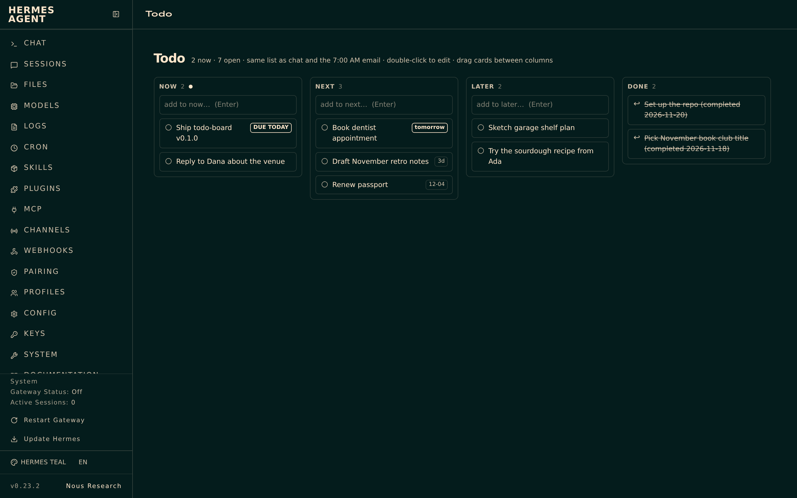
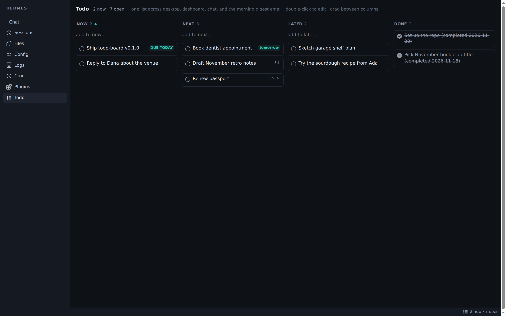

# hermes-todo-board

A personal kanban board for [Hermes Agent](https://github.com/NousResearch/hermes-agent), backed by one plain markdown file — `~/Documents/todo.md` — shared by every surface:

| Surface | What you get |
|---|---|
| **Hermes desktop app** | A **Todo** page in the sidebar, a ⌘K palette command, and a live `2 now · 5 open` chip in the status bar |
| **Web dashboard** | A **Todo** tab with the same board |
| **Anything else that edits the file** | Plain markdown, so chat agents, scripts, and digest crons can read and write the same list — every change shows up on the board within seconds |

No database, no accounts, no sync service, no third-party calls. One file, one API, two native UIs.

## Screenshots

### Web dashboard — the Todo tab



*(demo data)*

### Desktop app — Todo page and status-bar chip



*(component preview rendered from `desktop/plugin.js` — demo data)*

The desktop half is the same board built from the desktop app's own design system: a **Todo** page in the sidebar, a `Todo: open board` ⌘K command, and a live `N now · M open` chip pinned to the status bar.

## Install

```bash
hermes plugins install BColsey/hermes-todo-board
```

Or from an app: **Settings → Plugins → Install from Git**, paste `BColsey/hermes-todo-board`.

After installing:

1. **Enable the backend** — add `todo-board` to `plugins.enabled` in your Hermes `config.yaml` (the dashboard plugin settings form does the same). This serves the board API at `/api/plugins/todo-board` from your gateway and adds the dashboard tab.
2. **Enable the desktop half** (desktop app only) — toggle **Todo Board** under Settings → Plugins. Like every unified plugin's desktop UI, it ships opt-in and loads after you flip it on.
3. **Create the file** if you do not have one yet. The board reads and writes `~/Documents/todo.md` on the machine running your Hermes gateway:

```markdown
# My todo list

## Now

- [ ] Ship v0.1.0 [by 2026-11-22]

## Next

- [ ] Write the changelog

## Later

## Done

- [x] Set up the repo (completed 2026-11-20)
```

## How it works

- Four fixed sections — **Now / Next / Later / Done** — parsed from `## Section` headings and `- [ ]` / `- [x]` items. Anything above the first heading is preserved untouched.
- Add (Enter in a column), edit (double-click a card), complete/reopen (the circle button), drag cards between columns. Every write rewrites the file atomically.
- **Deadline chips**: append `[by 2026-12-01]` to any item. Both UIs render `DUE TODAY`, `tomorrow`, `3d`, and `12-01` chips, highlighted when the deadline is today or past (`overdue 2d`).
- Completing an item stamps it `(completed YYYY-MM-DD)` into **Done**; reopening returns it to **Next**. Item text is capped at 300 characters.
- Boards poll every 10 s (the status chip every 30 s) — no socket dependency, so the behavior is identical on OAuth remote gateways.

### REST API

Both UIs talk to the same plugin backend on your gateway. Auth is whatever already protects your dashboard — the plugin adds none of its own.

| Method | Path | Body |
|---|---|---|
| `GET` | `/api/plugins/todo-board/todo` | — returns sections, counts, open count, mtime |
| `POST` | `/api/plugins/todo-board/todo` | `{op: add\|edit\|complete\|move\|reload, section, idx, text, to_section, to_idx}` |

## Configuration

Zero configuration. The file path is fixed — `~/Documents/todo.md` of the user running the Hermes gateway — and so are the sections. (A configurable path and digest schedule arrive with the settings schema in a later release.)

## Remote-backend topology

The common Hermes deployment: the **gateway runs on a server**, and you use the **desktop app from a laptop or PC** and the dashboard from any browser. This plugin is built for exactly that split:

- `todo.md` lives on the **gateway host** — there is exactly one copy, on the server.
- The **desktop half installs on the app machine** (`$HERMES_HOME/desktop-plugins/todo-board/`) and reads/writes through the gateway's plugin API. It never touches local files, so the app machine needs no copy of your list.
- The **dashboard tab** is served by the gateway itself and always sees the server's file.
- If the app cannot reach the gateway, the board says `backend unreachable` instead of guessing.

Install the backend once (on the server), install the desktop half wherever you run the app — every surface stays in sync because there is only ever one file.

## Security & privacy

- Reads and writes **exactly one file**: `~/Documents/todo.md` on the gateway host. Nothing else on disk is touched.
- Talks **only to your own Hermes gateway's plugin API** — no third-party services, no telemetry, no accounts.
- No credentials, no shell commands, no background processes beyond the dashboard route you installed.
- UI strings are English-first; both halves are theme-aware (dashboard theme variables and the desktop app's `--ui-*` tokens — no hardcoded colors).

## Verifying & developing

```bash
git clone https://github.com/BColsey/hermes-todo-board
hermes plugins validate ./hermes-todo-board
```

```
plugin.yaml            manifest (name, version)
dashboard/             web dashboard half: Todo tab UI + FastAPI backend over todo.md
desktop/plugin.js      desktop half: Todo page, sidebar nav, palette command, status chip
```

## License

MIT — see [LICENSE](LICENSE).
